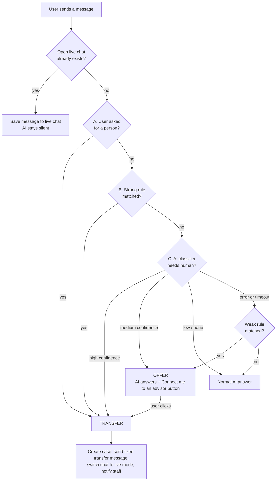
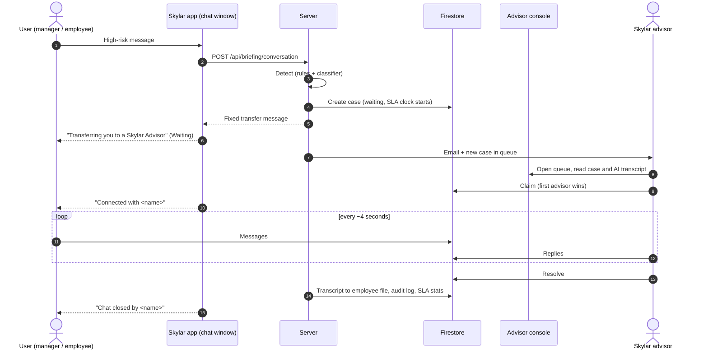
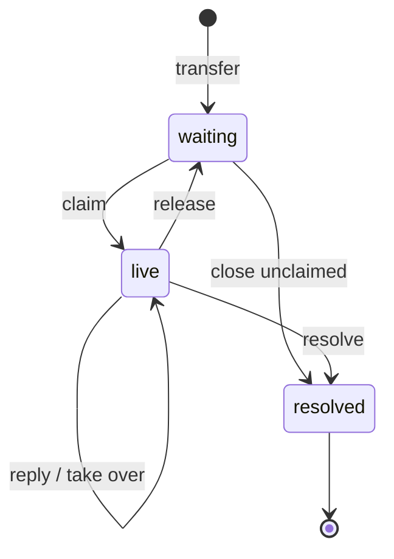
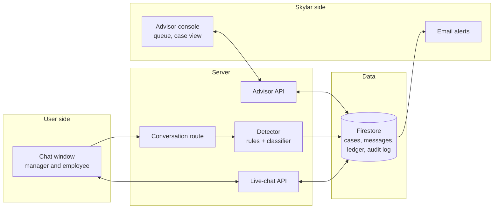
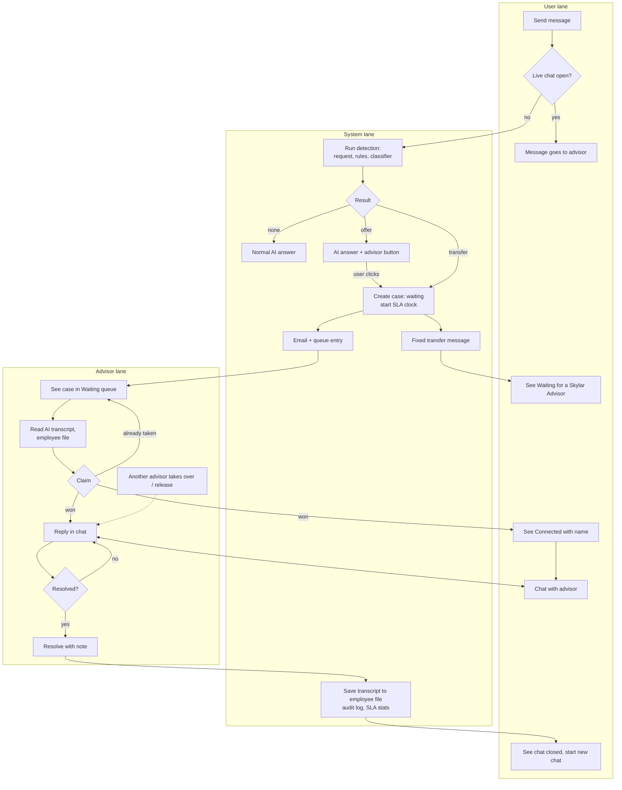
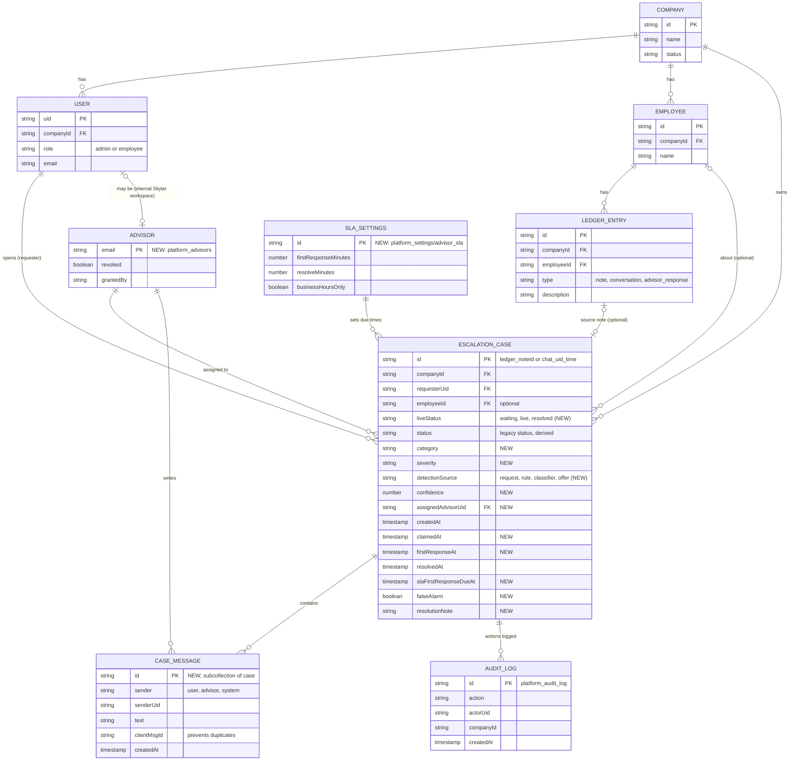

# Skylar: Live HR Advisor Escalation Plan

Date: 2026-10-23
Status: Built. Skylar answered the decisions in section 9 (see section 10); the code follows those answers.

## 1. Summary

When a conversation needs a person, the AI tells the user it is transferring the chat to a Skylar HR Advisor, and a real advisor takes over in the same chat window. Advisors work from a ticket-style console that shows incoming chats, lets any available advisor claim and answer one, and records every transcript and response time.

Escalations are detected in three layers (an explicit request, strong rules, and a small AI classifier), so people are transferred when they should be and borderline cases are offered a button instead of being forced.

A working version takes about 8 to 9 working days and needs no new infrastructure (polling instead of websockets, existing Firebase, Resend and Vercel setup).

We need Skylar's answers to the 10 decisions in section 9. Decisions 1, 5 and 9 matter most.

## 2. Today vs. the new experience

**Today**
- A high-risk message from a manager creates a red note and an advisor case, and the AI says it was escalated.
- The "advisor" is the customer's own admin on `/advisor`, inside their own workspace. There is no chat with a real person, no Skylar-side advisor role, and no measured response time.
- Employee chats are not saved and never escalate.
- Detection is one word list, so single words like "race", "legal" or "wage" trigger it, while paraphrases are missed.

**New**
- The user sees: "This needs one of our Skylar Advisors, so I'm transferring this chat to one now."
- The same chat window shows "Waiting for a Skylar Advisor", then "Connected with <name>", and the advisor chats with them live.
- Skylar advisors get a console across all workspaces. Every transcript is kept and every response time is measured.

## 3. How an escalation is detected

A server-side check runs on every message, before the AI answers.

| Layer | What it does | Result |
|---|---|---|
| A. User asks for a person | "Talk to an advisor", "I want a human", or taps an always-visible "Talk to an advisor" button | Transfer immediately |
| B. Strong rules | Existing word list tightened to multi-word patterns such as "sexual harassment", "filed a complaint", "final warning", "FMLA". Weak single words (race, gender, legal, wage) no longer trigger alone | Strong match: transfer. Weak match: goes to layer C |
| C. AI classifier | A small, fast Claude call reads the last few turns and returns whether a human is needed, the category, severity and confidence | High confidence: transfer. Medium: offer a "Connect me to an advisor" button. Low: do nothing |

Safeguards
- If the classifier fails or times out, we fall back to the rules; a weak match becomes an offer, so a possible high-risk matter is never silently ignored.
- The AI never gives advice on the substance of a transferred matter. It sends one fixed, approved message.
- Each case stores why it was detected (source, category, confidence). Advisors can mark "false alarm" on resolve, and Skylar reviews these to tune thresholds.
- A feature flag (`LIVE_ADVISOR_ENABLED`) switches back to today's behavior instantly.

### 3.1 Detection decision flow

## 4. End-to-end flow

### 4.1 Who does what

### 4.2 Case states

### 4.3 System overview

## 5. How a real human takes over

- Any Skylar advisor can claim a waiting case; the first to claim wins, others see "already taken by <name>".
- Any advisor can open any case to read it. Replying requires owning it.
- Take over: an advisor can take a live case from another advisor (for example at a shift change). Release returns it to the waiting queue.
- Resolve closes it with an optional note. "Close unclaimed" handles duplicates or spam.
- While a case is live the AI never replies in that thread.
- Optional (decision 10): let an advisor join an AI chat that was only offered an advisor and not accepted. Off by default.

### 5.1 Use cases

Actors: **User** (manager or employee), **Skylar advisor**, **Super admin** (Skylar), **Customer admin**, and the **System** (AI and automation).

```mermaid
flowchart LR
    U([User<br/>manager / employee])
    A([Skylar advisor])
    SA([Super admin])
    CA([Customer admin])
    SYS([System<br/>AI + automation])

    subgraph UC1[Chat and escalation]
      u1((Chat with AI))
      u2((Ask for an advisor<br/>button or words))
      u3((Accept the offer<br/>Connect me to an advisor))
      u4((Chat live with advisor))
      u5((See waiting / connected / closed status))
      u6((Start a new chat))
    end
    subgraph UC2[Advisor work]
      a1((View queue and SLA timers))
      a2((Claim a case))
      a3((Read AI transcript<br/>and employee file))
      a4((Reply to user))
      a5((Take over / release a case))
      a6((Resolve or close unclaimed))
      a7((Mark false alarm))
      a8((Export transcript))
    end
    subgraph UC3[Administration]
      s1((Grant / revoke advisors))
      s2((Set response-time targets))
      s3((View SLA reports))
      s4((View audit log))
      c1((View workspace cases<br/>read-only))
    end
    subgraph UC4[Automation]
      y1((Detect high-risk message))
      y2((Send fixed transfer message))
      y3((Create case and start SLA clock))
      y4((Notify staff by email))
      y5((Save transcript to employee file))
      y6((Flag SLA at risk / breached))
    end

    U --- u1 & u2 & u3 & u4 & u5 & u6
    A --- a1 & a2 & a3 & a4 & a5 & a6 & a7 & a8
    SA --- s1 & s2 & s3 & s4
    SA --- a1
    CA --- c1
    SYS --- y1 & y2 & y3 & y4 & y5 & y6
```

| # | Use case | Actor | Main flow | Result |
|---|---|---|---|---|
| UC-1 | Escalate to an advisor | User, System | User writes a risky message or asks for a person, system detects it, sends the fixed message, creates a waiting case | Chat shows "Waiting for a Skylar Advisor" |
| UC-2 | Accept an offered advisor | User | AI answers and shows a "Connect me to an advisor" button, user clicks | Same as UC-1 |
| UC-3 | Claim and answer | Advisor | Open queue, pick the oldest waiting case, read context, claim, reply | User sees "Connected with <name>" |
| UC-4 | Take over | Advisor | Open an active case owned by someone else, take over (or release) | Case reassigned, system note in the chat |
| UC-5 | Resolve | Advisor | Add optional note, resolve (or close unclaimed) | Chat closed, transcript saved, stats updated |
| UC-6 | Manage advisors and targets | Super admin | Grant or revoke advisor access, set response-time targets | Access and targets apply immediately, audit-logged |
| UC-7 | Review service levels | Super admin | Open Platform Overview SLA panel | Median, 90th percentile, breaches, per advisor |
| UC-8 | Review a workspace's cases | Customer admin | Open Advisor page (read-only) | Sees cases and transcripts for their own workspace only |

### 5.2 Master flowchart (user, system and advisor lanes)

## 6. Advisor console, transcripts and service levels

**Console** (`/platform/advisor`, Skylar staff only)
- Tabs: Waiting, Mine, All active, Resolved. Oldest waiting first, search, a response-time badge on every row (turns amber, then red).
- Case view: full conversation including what the AI said before the transfer, the employee's file and recent notes (read-only), reply box, Claim / Take over / Release / Resolve.
- Advisor access is granted and revoked at runtime by a super admin, and every advisor action is audit-logged.

**Transcripts**
- Every message is stored with sender and time. On resolve the whole conversation is saved to the employee's file and appears in People and Documents.
- Export to text or CSV per case. Deletes follow the existing 30-day soft-delete policy.

**Service levels**
- Captured per case: created, claimed, first reply, resolved.
- Reported on the platform Overview: cases, median and 90th percentile time to first reply, percent within target, breaches, open now, and per advisor.
- Targets are editable. The current default is 4 business hours for a first reply.

### 6.1 Data model (ERD)

Existing collections are shown with their key fields; **new** ones are marked. Firestore has no joins, so relationships are by stored ids.

Relationship notes
- One case belongs to one company and one requesting user; it may link to an employee and to the note that triggered it. Old cases (hold-to-escalate) keep working unchanged.
- Messages are a subcollection of the case, so a transcript is one query.
- Advisors are users in an internal Skylar workspace plus an entry in the advisors list; every advisor action writes an audit-log entry.

## 7. Build phases (about 8 to 9 working days)

| Phase | What | Days |
|---|---|---|
| 0 | Confirm decisions, write the ticket | 0.5 |
| 1 | Detection, case model, advisor role | 1.5 |
| 2 | Handoff and live chat in the user's chat window | 2 |
| 3 | Advisor console: queue, claim, take over, reply, resolve | 2.5 |
| 4 | Transcripts and response-time reporting | 1.5 |
| 5 | Email notifications and polish | 1 |

Phases 1 to 3 (about 6 days) already deliver "the chat transfers to a real person who answers". Everything ships behind a feature flag.

## 8. Risks and how we handle them

| Risk | Handling |
|---|---|
| False alarms flood advisors | Tightened rules, offer button for borderline cases, "false alarm" tagging and weekly tuning |
| A real case is missed | Three layers, fail-safe fallback to an offer, always-visible "Talk to an advisor" button |
| Nobody is online | Waiting message with expected time, email to staff, response-time clock and breach alerts (staffing decision 2) |
| Advisors see other companies' data | Access limited to named advisors, every read and action audit-logged |
| Free users get human time | Payment rule to be decided (decision 5) |
| Stripe not yet live | Billing has only been tested with mocks; payment gating depends on keys from the client |

## 9. Decisions needed from Skylar

1. Managers only, or employees too? (Employee chats are not saved today, so this adds work.)
2. How many advisors, and what should users see outside working hours?
3. Response-time targets, and do they count business hours only?
4. Shared queue where any advisor claims (our default), or round-robin or a named advisor?
5. Do free users get a human advisor, or only paying users ($149/month after the 14-day trial)? Do human messages count against the free-message limit?
6. Should the customer's own admins see their workspace's live transcripts (read-only)?
7. Can a user reopen a resolved chat within 24 hours, or start a new one?
8. Exact wording of the transfer message, and whether it may include safe interim tips (hold off acting, write down facts and dates, keep it confidential).
9. Transfer automatically only on strong signals and offer a button for borderline ones (our default), or transfer on any match?
10. May advisors proactively join an AI chat that was only offered an advisor, or only chats the user accepted?

## 10. Skylar's answers

1. Managers only. Employees are never escalated.
2. One advisor for now. Outside working hours the user sees: "Your advisor has been notified and may take up to 6 hours to respond. You can close the app and we will notify you when your advisor has reviewed."
3. Business hours only. No response-time metrics for now.
4. Shared queue. The first advisor to claim a case owns it.
5. Every account gets free messages until the 14-day trial ends. Human messages count against the free-message limit.
6. Yes. The customer's own admins can read their workspace's live transcripts, read-only. They are listed under "Advisor chats" on the employee's file. Only the manager who opened a case can reply.
7. No reopening. A user starts a new chat (`ADVISOR_ALLOW_REOPEN` stays off).
8. Transfer message: "We believe that this issue requires an escalation to one of our Live (Human) HR Advisors. We are transferring this now to your advisor. It may take up to an hour for the advisor to respond. You may leave the app and you will be notified when your advisor has read the case. In the meantime, hold off acting, write down all the facts and dates, keep it confidential." Outside working hours the 6-hour wording replaces the one hour.
9. Transfer automatically only on strong signals; offer a button on borderline ones. The user can decline.
10. Advisors can take only chats that have been transferred to them.
